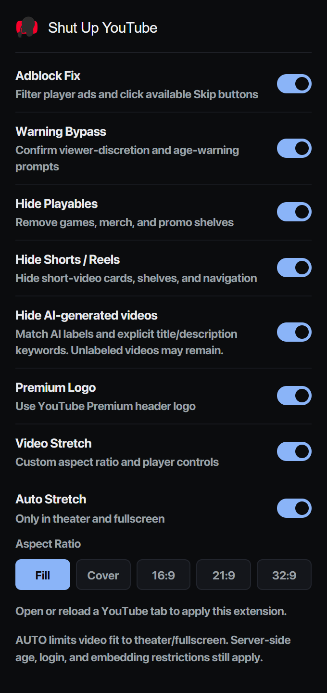

<p align="center">
  
</p>

<h1 align="center">Shut Up YouTube</h1>

<p align="center">
  <strong>A quieter YouTube, on your terms.</strong><br>
  Filter ads, hide distracting feeds, and make the player fit your screen.
</p>

<p align="center">
  <a href="manifest.json"></a>
  <a href="manifest.json"></a>
  <a href="#installation"></a>
  <a href="LICENSE"></a>
</p>

<p align="center">
  <a href="#installation">Install</a> &middot;
  <a href="#features">Features</a> &middot;
  <a href="#player-controls">Player controls</a> &middot;
  <a href="#development">Development</a> &middot;
  <a href="https://github.com/rainaku/Shut-Up-YouTube/issues">Report a bug</a>
</p>

Shut Up YouTube is a lightweight browser extension for desktop Chromium browsers. It runs on YouTube pages and matching embeds, with independent feature switches and preferences that persist across sessions. Plain JavaScript, no build step, no runtime dependencies.

## Features

| Feature | What it does |
| :--- | :--- |
| **Adblock Fix** | Removes supported ad fields from player responses, hides banner and feed ad slots, and clicks available Skip Ad buttons. |
| **Warning Bypass** | Confirms supported **Continue / I understand** content-warning prompts, including English and Vietnamese controls. |
| **Hide Playables** | Hides mini-games, merchandise shelves, and ticket promotions. |
| **Hide Shorts / Reels** | Hides short-video cards, dedicated shelves, and navigation entries. |
| **Hide AI-generated videos** | Filters cards with AI disclosures or explicit generation phrases in their titles or description snippets. |
| **Premium Logo** | Replaces the header logo with the YouTube Premium logo. Cosmetic only; no subscription benefits. |
| **Video Stretch** | Adds five fit modes, ultrawide ratios, and quick controls inside the player. |

All feature switches are **on by default**, with **Fill** selected and **Auto Stretch** limiting video fit to Theater and Fullscreen. The extension also hides ambient video glow.

<details>
<summary><strong>Preview the extension popup</strong></summary>

<p align="center">
  
</p>

<p align="center"><sub>Actual popup with default settings. Page status depends on the active tab.</sub></p>

</details>

> [!NOTE]
> Ad filtering is best effort. The extension cannot override server-side playback blocks, sign-in or age-verification requirements, or embedding restrictions. Warning confirmation works only when YouTube provides a native confirmation action.

## Installation

Load the source directly as an unpacked extension. **Node.js and npm are only needed for development and tests.**

1. Get the source using **Code → Download ZIP** on [this repository](https://github.com/rainaku/Shut-Up-YouTube), then extract it. Or clone it:

   ```sh
   git clone https://github.com/rainaku/Shut-Up-YouTube.git
   ```

2. Open your browser's extensions manager:

   | Browser | Address |
   | :--- | :--- |
   | Google Chrome | `chrome://extensions` |
   | Microsoft Edge | `edge://extensions` |
   | Brave | `brave://extensions` |
   | Vivaldi | `vivaldi://extensions` |

3. Enable **Developer mode**, click **Load unpacked**, and select the extracted or cloned folder **containing `manifest.json`**.
4. Open or refresh YouTube. Pin **Shut Up YouTube** in your browser toolbar to reach its settings quickly.

The current package targets Chromium desktop browsers; Firefox and Safari are not supported by this manifest.

### Updating

Update the source in the folder you loaded, click **Reload** on the extension's card, then **refresh every open YouTube tab**. Existing pages keep the old content scripts until refreshed.

Popup changes apply immediately after installation or reload. Ad data already consumed by a player may require refreshing the video.

## Player controls

Two buttons appear in the bottom-right player controls, including supported YouTube embeds:

| Button | Behavior |
| :--- | :--- |
| **FIT** | Turns custom video fitting on or off. Turning it off restores YouTube's original video layout. |
| **AUTO** | When on, applies fitting only in Theater and Fullscreen. Turn it off to use the selected ratio in the standard player too. |

Choose a mode in the extension popup:

| Mode | Result |
| :--- | :--- |
| **Fill** | Stretches the video to fill the player edge to edge; may distort the image. |
| **Cover** | Fills the player while preserving the source proportions; crops the edges when necessary. |
| **16:9** | Reshapes the video to widescreen proportions within the player. |
| **21:9** | Reshapes the video to ultrawide proportions within the player. |
| **32:9** | Reshapes the video to super-ultrawide proportions within the player. |

Fixed ratios can distort the source image. Use **Cover** when preserving proportions matters more than keeping every edge visible. Video dimensions follow the player as it resizes.

**FIT is on but nothing changes?** AUTO is also on by default. Switch to Theater or Fullscreen, or turn AUTO off.

## How filtering works

### Shorts and AI-labeled videos

Both feed filters work independently across supported Home, Search, Subscriptions, channel, playlist, and recommendation layouts. They react to newly loaded and reused cards during navigation. Turning a filter off restores matching cards without a page reload; directly opened videos keep their player.

The AI filter reads metadata **already present on a video card**. Examples include:

- Disclosures such as `Made with AI` and `Altered or synthetic content`.
- Explicit phrases such as `AI-generated`, `generated with AI`, `được tạo bằng AI`, and `do AI tạo`.

It does not analyze footage, fetch every video's description, or contact an AI service. A bare mention of `AI`, a tool name, or a channel name is not enough to match.

**Unlabeled videos can remain visible.** The filter can also hide videos discussing AI-generated content when their card contains a matching phrase. Turn the filter off to restore them.

### Ads and content warnings

Ad filtering operates on initial player data and supported fetch/XHR player responses. Recognized adblock playback errors remain visible, with an explanation in the popup. The extension does not force reload loops or replace the player to conceal a failure.

Warning Bypass uses YouTube's native confirmation control and preserves its original parameters. It supports late-initializing controls with up to four confirmation attempts. The popup distinguishes waiting, confirming, video ready, and failed confirmation; clicking a button alone is not treated as successful playback.

If YouTube only offers **Sign in** or **Verify your age**, that requirement remains visible. The extension does not click those controls or **Learn more**.

## Privacy and permissions

The extension processes page content in your browser, with **no analytics, telemetry, or developer-operated backend**. Its scripts and assets are bundled locally.

| Permission or access | Why it is needed |
| :--- | :--- |
| `storage` | Saves feature switches and the selected ratio through `chrome.storage.sync`. Your browser may synchronize these preferences if you enable profile sync. |
| `*://*.youtube.com/*` | Applies filters and controls to YouTube pages and matching embedded frames. |
| `*://*.youtube-nocookie.com/*` | Supports YouTube's privacy-enhanced embedded player. |

See the [Privacy Policy](PRIVACY_POLICY.md) for the project's data-handling policy.

## Troubleshooting

| Symptom | What to check |
| :--- | :--- |
| Nothing changes after an update | Reload the extension, then refresh the YouTube tab. Confirm that the selected folder contains `manifest.json`. |
| FIT appears enabled but the video looks unchanged | AUTO limits fitting to Theater and Fullscreen. Change viewing mode or disable AUTO. |
| A video card disappears unexpectedly | Turn off **Hide Shorts / Reels** or **Hide AI-generated videos** to identify the matching filter and restore the card. |
| YouTube still shows an adblock error | Read the popup status. A server-side playback denial cannot be fixed by removing ad fields. |
| A warning remains on screen | Check whether YouTube offers a native confirmation action or requires sign-in/verification. The popup reports pending and failed confirmations. |

For a reproducible problem, [open an issue](https://github.com/rainaku/Shut-Up-YouTube/issues) with your browser version, extension version, relevant settings, page URL, and steps to reproduce. Include the popup status or a screenshot when useful; omit account details and other private information.

## Development

Use **Node.js 20+** and npm. The extension itself runs directly from source; Playwright is a development dependency.

```sh
npm ci
npx playwright install chromium
npm test
```

The regression suite loads the actual unpacked extension, including its isolated and MAIN execution worlds, against controlled YouTube fixtures. It covers settings persistence, popup/player synchronization, fit geometry, dynamic feed filtering and restoration, native warning confirmation, ad-response filtering, embeds, and navigation without reload loops.

### Project structure

```text
.
├── manifest.json          # Permissions, entry points, and script load order
├── settings.js            # Shared defaults and preference validation
├── inject.js              # MAIN-world player-response filtering
├── content.js              # Player controls, video fit, and feature coordination
├── content.css             # Page cleanup and player styling
├── activity.js             # Scoped DOM observers and page lifecycle
├── filters.js              # Shorts and AI-metadata feed filters
├── warnings.js             # Native warning confirmation and status
├── logo.js                 # Header logo replacement and restoration
├── popup.html / popup.js   # Settings UI and active-tab status
├── sw.js                   # Preference initialization on install/update
├── icons/                  # Bundled extension artwork
├── docs/images/            # README screenshots
└── tests/                  # Fixtures, regression tests, and live checks
```

### Performance

Work is driven by relevant DOM events, with scoped observers and short batches for feed updates. Visual observers and queued filtering pause in hidden tabs and catch up when visible. Player response hooks preserve the original network response and byte stream; completed JSON/text reads are filtered, while raw stream and binary reads pass through.

```sh
npm run test:performance
```

The local benchmark measures idle activity, unrelated comment updates, a 600-card feed, and repeated logo replacement. It reports DOM query counts, browser task time, and retained nodes. These measurements describe extension overhead, not YouTube network latency or total browser memory.

### Optional live checks

These commands contact YouTube using temporary, signed-out browser profiles. They do not use your personal browser profile. Consent, network, login, and bot restrictions can affect results.

| Command | Checks |
| :--- | :--- |
| `npm run test:live` | Reports playback progress, controls, and page errors. |
| `npm run test:navigation` | Checks sustained playback through recommendation clicks. |
| `npm run test:filters` | Toggles Shorts/AI filters on real search results and checks restoration. |
| `npm run test:warning -- "https://www.youtube.com/watch?v=NtKX__-qPSI"` | Tests the supplied video's native warning with the feature off, then on. |
| `npm run test:warning -- "https://www.youtube.com/watch?v=NtKX__-qPSI" --cold` | Tests a fresh profile with warning confirmation already enabled. |

Live checks save screenshots and, where applicable, reports in `test-results/`. The AI check requires a result with an explicit matching title; it does not validate detection of unlabeled footage. Playback of an unrestricted video does not prove that server-side restrictions can be bypassed.

## Contributing

Bug reports, compatibility fixes, and focused pull requests are welcome.

1. Describe the problem and how to reproduce it, or reference an existing issue.
2. Keep changes focused on the relevant module and add regression coverage for behavior changes.
3. Run `npm test`. For observer or feed-processing changes, also run `npm run test:performance`.
4. Include the browser version, validation performed, and any remaining limitations in your pull request.

## License

[MIT](LICENSE) © 2026 w0otdev.

An independent open-source project, not affiliated with or endorsed by YouTube or Google. Provided as-is; see the [Terms of Service](TERMS_OF_SERVICE.md).
